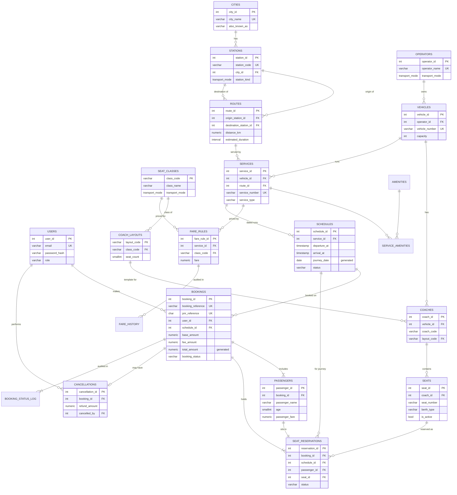

# TN Transit — Tamil Nadu Bus & Railway Reservation System

A full-stack DBMS project: search, reserve, view and cancel **bus and train** seats between Tamil Nadu cities, with an admin dashboard for running the network. The PostgreSQL schema, constraints, views, stored functions and transactions are the core of the project. The React frontend and a thin Express API exist to drive them.

> **Demonstration data.** Operators, service numbers, timetables, fares, availability and "App PNR" numbers are fictional. This is not an official TNSTC, SETC or Indian Railways service, and no real payment is taken.

---

## Contents

1. [Problem statement & objectives](#1-problem-statement--objectives)
2. [Features](#2-features)
3. [Technology stack & architecture](#3-technology-stack--architecture)
4. [Running the project](#4-running-the-project)
5. [Demo accounts & a 5-minute demo script](#5-demo-accounts--a-5-minute-demo-script)
6. [ER diagram](#6-er-diagram)
7. [Relational schema](#7-relational-schema)
8. [Keys, relationships and cardinalities](#8-keys-relationships-and-cardinalities)
9. [Normalization (1NF → 3NF)](#9-normalization-1nf--3nf)
10. [Booking transaction flow](#10-booking-transaction-flow)
11. [Seat availability & concurrency](#11-seat-availability--concurrency)
12. [Cancellation flow](#12-cancellation-flow)
13. [Views, functions, triggers, indexes](#13-views-functions-triggers-indexes)
14. [Important SQL queries](#14-important-sql-queries)
15. [DBMS concepts demonstrated](#15-dbms-concepts-demonstrated)
16. [API reference](#16-api-reference)
17. [Testing](#17-testing)
18. [Project structure](#18-project-structure)
19. [Limitations & future enhancements](#19-limitations--future-enhancements)

---

## 1. Problem statement & objectives

Travellers in Tamil Nadu use separate systems for state buses, private operators and railways, and none of them shows the options side by side. A reservation system also has a hard correctness problem: **two people must never be sold the same seat on the same journey**, even when they click "Book" at the same moment.

**Objectives**

- Model buses and trains in **one normalized relational schema** without duplicating booking logic per mode.
- Treat seat availability as a property of a **journey (schedule)**, not of a physical seat.
- Make double-booking **impossible at the database level**, not just checked in the UI.
- Keep bookings, passengers and cancellations as **permanent history**: cancelling releases seats without deleting anything.
- Compute every report and dashboard number with **SQL aggregation**.
- Keep the backend thin and the SQL visible, so the design is easy to explain in a viva.

## 2. Features

**Passengers**
- Search between 15 Tamil Nadu cities by date, Bus or Train, and passenger count. Aliases work too: "Trichy", "Ooty", "Kovai".
- Real, **server-side** filters: departure/arrival time band, price range, bus type or train category, availability. Sort by departure, fare, duration, arrival or seats.
- Date strip, modify-search panel, and loading, empty, error and "no service on this date — try these dates" states.
- **Interactive seat maps drawn from database rows**: 2+2 and 2+3 seaters, sleeper buses with lower and upper decks, and train coaches with LB/MB/UB/SL/SU berths (SL, 3A, 2A, 1A) or chair-car seats (CC). Includes berth preference with auto-select, a passenger limit (max 6), and a consistent four-state legend.
- Checkout with validation, a fare breakdown (base fare, configured booking fee, total) and a **Demo Payment / Confirm Booking** button.
- Ticket page loaded from PostgreSQL by reference, with a print/PDF layout.
- My Bookings (Upcoming, Past and Cancelled tabs, mode filter, reference/PNR search) and a cancellation modal with a live refund quote.
- Registration, login and logout with bcrypt-hashed passwords and server-side sessions. Profile with booking statistics and password change.

**Administrators** (role-checked on the server)
- Dashboard: 8 KPI tiles, a bookings-per-day chart by mode, revenue split, top routes, popular destinations (HAVING), fullest upcoming journeys and latest bookings.
- **SQL reports page**: 12 named queries, each shown as SQL text next to its live result.
- CRUD with search, filters, validation and safe deletes for cities, stations, routes, operators, buses and trains, services (with amenities, M:N), schedules (bulk create with `generate_series`), seats and coaches (coaches generated by a stored function, plus individual seat blocking), fares and booking fees (with trigger-written fare history), booking records (admin cancel) and cancellation records.

## 3. Technology stack & architecture

| Layer | Technology |
|---|---|
| Database | **PostgreSQL** (developed and tested on 18.6; 14+ should work) |
| API | Node.js 20+, **Express 5**, `pg` (connection pool), `express-session` + `connect-pg-simple`, `bcryptjs` |
| Frontend | **React 18 + TypeScript + Vite**, Tailwind CSS v4, React Router, Lucide icons, Recharts |

```
 Browser (React SPA)
      │  fetch /api/...  (JSON, session cookie)
      ▼
 Express API ── validation + parameterized SQL only ─────────────┐
      │  pg Pool (10 connections)                                │
      │  withTransaction(): BEGIN … COMMIT / ROLLBACK on ONE      │
      │  dedicated connection                                     │
      ▼                                                            │
 PostgreSQL ── tables + constraints + views + functions + triggers ┘
               (the business rules live here)
```

The API deliberately has **no service layer**. Each controller file starts with a `SQL` object holding every statement it runs, so "where is the query for X?" always has a one-file answer.

### Visual design

The interface follows the project's own design mockup: warm cream surfaces, rounded white cards, brick-maroon primary actions, deep forest-green panels and secondary actions, and painted scenes of Tamil Nadu.

- **Colour tokens** (in [client/src/index.css](client/src/index.css)):

  | Token | Role |
  |---|---|
  | `clay` | maroon actions |
  | `slate` | green sidebars, tabs, selected seats |
  | `paper` | cream surfaces |
  | `sun` | peach icon circles |
  | `booked` | pink booked seats |
  | `moss` | confirmed status |

  Chart colours were checked with a colour-blindness validator.
- **Type:** DM Serif Display for headings, Inter for text, Caveat for the handwritten taglines, and Noto Serif Tamil for Tamil place names.
- **Layouts:** a top-header shell (home, seat selection, checkout, ticket) and a dark-green sidebar shell (search results, My Bookings, Profile). Booking pages show a numbered stepper: Seats → Passenger Details → Confirmation.
- **Graphics:** painted Tamil Nadu scenes are panels cropped from two illustration collages into [client/public/scenes](client/public/scenes) (WebP, ~550 KB total); the rest is SVG in [client/src/components](client/src/components):
  - `Illustrations`: `ScenePhoto` (hero collage, destination cards, sidebars, confirmation page, bus/train card headers; `CITY_SCENE` maps cities to scenes), palm corners, and a fallback landmark glyph per city.
  - `NetworkMap`: a metro-style diagram of the 15 cities that lights up the cities chosen in the search card.
- **Motion:** a scroll-progress bar, collage parallax, reveal-on-scroll, swaying palms, and moving vehicles. All of it is disabled when the OS asks for reduced motion.

## 4. Running the project

### Prerequisites
- Node.js **20 or newer** (`node -v`)
- PostgreSQL **14 or newer**, running locally, and the password of a user that can create a database (usually `postgres`)

### Steps

```bash
# 1. Install dependencies for root, server and client
npm run install:all

# 2. Configure the database connection
#    Copy server/.env.example to server/.env and set PGPASSWORD (and PGUSER/PGPORT if different).
#    On Windows PowerShell:  Copy-Item server/.env.example server/.env

# 3. Create the database and load schema + functions + views + seed data
npm run db:setup
#    -> Created database tn_transit / ran schema.sql, functions.sql, views.sql, seed.sql

# 4. Start the API (port 4000) and the web app (port 5173) together
npm run dev
#    open http://localhost:5173
```

**Single-port alternative:** `npm run build`, then `npm start`. Express serves the built app at http://localhost:4000.

**Manual SQL alternative** (if you prefer psql):

```bash
createdb tn_transit
psql -d tn_transit -c "ALTER DATABASE tn_transit SET timezone TO 'Asia/Kolkata'"
psql -d tn_transit -f database/schema.sql
psql -d tn_transit -f database/functions.sql
psql -d tn_transit -f database/views.sql
psql -d tn_transit -f database/seed.sql
```

**Resetting:** run `npm run db:setup` again at any time. The seed truncates and reloads everything, so it never creates duplicate rows. Journey dates are relative to `CURRENT_DATE` (21 days back to 30 days ahead), so the demo always has both past and upcoming trips.

### Environment variables (`server/.env`)

| Variable | Meaning | Default |
|---|---|---|
| `PGHOST`, `PGPORT`, `PGUSER`, `PGPASSWORD` | PostgreSQL connection | localhost, 5432, postgres, — |
| `PGDATABASE` | database name | `tn_transit` |
| `SESSION_SECRET` | signs the session cookie, so use a long random string | dev fallback |
| `PORT` | API port | 4000 |

`.env` is git-ignored. Never commit real credentials.

## 5. Demo accounts & a 5-minute demo script

| Role | Email | Password |
|---|---|---|
| Administrator | `admin@tntransit.demo` | `Admin@123` |
| Passenger with history | `priya@example.com` | `Demo@123` |
| Other passengers | `arun@`, `kavya@`, `irfan@`, `lakshmi@`, `deepa@`, `vignesh@`, `sneha@`, `karthik@example.com` | `Demo@123` |

The login page has one-click buttons that fill these in.

**Suggested viva demo**
1. Home → Chennai → Coimbatore, Bus, tomorrow, 2 passengers → **Search**. Apply "After 6 PM", then a max price, and watch the results change. Each change is a new SQL query.
2. **Select seats** on *Marina Night Sleeper* → pick two berths across the decks → **Continue** → log in as Priya.
3. Submit the empty form to show validation, fill it in, and **Demo Payment / Confirm Booking**. The ticket page is loaded from the database. Refresh it to show it persisted.
4. In psql: `SELECT * FROM booking_details_view WHERE booking_reference = 'TNT…';`
5. Open the same seat map in another browser and try the same seats. You get **409: seat was just booked**.
6. **Cancel** the booking → refund quote → confirm. The seats show as free again, and the booking remains in **My Bookings → Cancelled**.
7. Log in as admin → Dashboard → **SQL reports** → run "Popular destinations (HAVING)".
8. Admin → **Fares & fees** → change a fare → the change appears under *Fare change history*, written by a trigger. Old tickets keep their fare.

## 6. ER diagram



Supporting tables not drawn above: `booking_fees` (fee per transport mode), `cancellation_policy` (refund bands), `amenities`, `fare_history`, `booking_status_log` and `user_sessions`.

## 7. Relational schema

Underlined = primary key, *italic* = foreign key. Full DDL is in [database/schema.sql](database/schema.sql).

| Table | Columns |
|---|---|
| users | <u>user_id</u>, full_name, email (unique, case-insensitive), phone, password_hash, role, created_at |
| cities | <u>city_id</u>, city_name, state, also_known_as · UNIQUE(city_name, state) |
| stations | <u>station_id</u>, station_name, station_code (unique), *city_id*, station_kind |
| operators | <u>operator_id</u>, operator_name (unique), transport_mode, contact_phone, is_active |
| seat_classes | <u>class_code</u>, class_name, transport_mode, is_ac, display_order |
| vehicles | <u>vehicle_id</u>, *operator_id*, vehicle_name, vehicle_number (unique), vehicle_type, capacity, is_active |
| coach_layouts | <u>layout_code</u>, layout_name, *class_code*, seat_count |
| coaches | <u>coach_id</u>, *vehicle_id*, coach_code, *layout_code* · UNIQUE(vehicle_id, coach_code) |
| seats | <u>seat_id</u>, *coach_id*, seat_number, berth_type, layout_row, layout_col, is_active · UNIQUE(coach_id, seat_number) |
| routes | <u>route_id</u>, *origin_station_id*, *destination_station_id*, distance_km, estimated_duration · CHECK(origin ≠ destination), UNIQUE(origin, destination) |
| services | <u>service_id</u>, *vehicle_id*, *route_id*, service_number (unique), service_name, service_type, is_active |
| amenities | <u>amenity_id</u>, amenity_name (unique) |
| service_amenities | <u>*service_id*, *amenity_id*</u> (composite PK) |
| fare_rules | <u>fare_rule_id</u>, *service_id*, *class_code*, fare, updated_at · UNIQUE(service_id, class_code) |
| booking_fees | <u>transport_mode</u>, fee_per_passenger |
| fare_history | <u>fare_history_id</u>, *fare_rule_id*, service_id, class_code, old_fare, new_fare, changed_at |
| schedules | <u>schedule_id</u>, *service_id*, departure_at, arrival_at, journey_date (generated), status, created_at · UNIQUE(service_id, journey_date) |
| bookings | <u>booking_id</u>, booking_reference (unique), pnr_reference (unique), *user_id*, *schedule_id*, contact_email, contact_phone, booked_at, base_amount, fee_amount, total_amount (generated), booking_status, payment_status |
| passengers | <u>passenger_id</u>, *booking_id*, passenger_name, age, gender, passenger_fare |
| seat_reservations | <u>reservation_id</u>, *(booking_id, schedule_id)*, *(passenger_id, booking_id)*, *seat_id*, status, reserved_at, released_at · **partial UNIQUE(schedule_id, seat_id) WHERE status = 'ACTIVE'** |
| cancellation_policy | <u>policy_id</u>, min_hours_before (unique), refund_percent |
| cancellations | <u>cancellation_id</u>, *booking_id* (unique), cancelled_at, cancellation_reason, refund_percent, refund_amount, refund_status, *cancelled_by* |
| booking_status_log | <u>log_id</u>, *booking_id*, old_status, new_status, changed_at |
| user_sessions | <u>sid</u>, sess, expire |

### Design decisions that differ from a "first draft" schema

| Decision | Why |
|---|---|
| `transport_mode` is **not** stored on `vehicles` | It is determined by the operator (vehicle → operator → mode). Storing it twice would be a transitive dependency and could disagree. |
| Class lives on `coach_layouts`, not on each seat | Every seat in an S1 coach is Sleeper. A class per seat would depend on only part of the key (the coach), so it belongs one level up. |
| Fares live in `fare_rules(service_id, class_code)`, not on `schedules` | A fare depends on service + class, not on the date or the seat. The fare **actually charged** is copied to `passengers.passenger_fare`, so later changes never touch old tickets. |
| `journey_date` and `total_amount` are **generated columns** | They are derived (`departure_at::date`, `base + fee`), and PostgreSQL computes them, so they can never be inconsistent. |
| Amenities are a junction table, not an array | Keeps `services` in 1NF and makes the many-to-many relationship explicit. |
| `seat_reservations` repeats `booking_id` and `schedule_id` | This *controlled* redundancy is needed so the partial unique index can be enforced. Composite foreign keys make it impossible for the repeated values to disagree with `bookings` or `passengers`. |
| Status columns + soft deactivation (`is_active`) | Cancelling, withdrawing or deactivating never deletes history. Referenced rows are protected with `ON DELETE RESTRICT`. |
| `transport_mode` is a **DOMAIN** | The allowed values (`'BUS'`, `'TRAIN'`) are defined once and reused by five tables. |

## 8. Keys, relationships and cardinalities

**Primary keys.** Every entity uses a surrogate `INTEGER GENERATED ALWAYS AS IDENTITY` key, except the natural keys `seat_classes.class_code`, `coach_layouts.layout_code` and `booking_fees.transport_mode`. `service_amenities` uses the composite key `(service_id, amenity_id)`.

**Candidate (unique) keys.** `users.lower(email)`, `stations.station_code`, `vehicles.vehicle_number`, `services.service_number`, `bookings.booking_reference`, `bookings.pnr_reference`, `(service_id, journey_date)`, `(service_id, class_code)`, `(origin_station_id, destination_station_id)` and `(vehicle_id, coach_code)`.

**Foreign keys** all use `ON DELETE RESTRICT`. The exceptions are `fare_rules` and `service_amenities`, which cascade from `services` because they are pure configuration. Deleting a city that has stations, a service that has schedules, or a schedule that has bookings is therefore refused by the database, and the API turns that into a 409 with a "deactivate instead" message.

| Relationship | Cardinality | Implemented by |
|---|---|---|
| City → Stations | 1 : N | `stations.city_id` |
| Station → Routes (as origin / as destination) | 1 : N (twice) | `routes.origin_station_id`, `routes.destination_station_id` |
| Operator → Vehicles | 1 : N | `vehicles.operator_id` |
| Vehicle → Coaches → Seats | 1 : N : N | `coaches.vehicle_id`, `seats.coach_id` |
| Vehicle → Services, Route → Services | 1 : N each | `services.vehicle_id`, `services.route_id` |
| Service ↔ Amenity | **M : N** | junction `service_amenities` |
| Service ↔ Seat class (with a fare) | **M : N** with attribute | `fare_rules` |
| Service → Schedules | 1 : N | `schedules.service_id` |
| User → Bookings | 1 : N | `bookings.user_id` |
| Schedule → Bookings | 1 : N | `bookings.schedule_id` |
| Booking → Passengers | 1 : N (at least 1) | `passengers.booking_id` |
| Schedule ↔ Seat (reservation) | **M : N** | associative entity `seat_reservations` |
| Passenger → Seat reservation | 1 : 1 | `seat_reservations.passenger_id UNIQUE` |
| Booking → Cancellation | 1 : 0..1 | `cancellations.booking_id UNIQUE` |

## 9. Normalization (1NF → 3NF)

- **1NF:** every column holds one atomic value. There are no repeating groups and no lists: amenities are rows in `service_amenities`, and passengers are rows, not columns like `passenger1_name`. Every table has a primary key.
- **2NF:** no non-key attribute depends on only part of a composite key.
  - `service_amenities(service_id, amenity_id)` has no other attributes.
  - In `fare_rules`, the fare depends on the whole `(service_id, class_code)` pair.
  - Seat class was moved off `seats` because it depended only on the coach (a partial dependency in a `(coach, seat_number)` view of the table).
- **3NF:** no non-key attribute depends on another non-key attribute.
  - The transport mode of a vehicle is reached through `operator_id`, not stored on `vehicles`.
  - A city name is reached through `stations.city_id`.
  - A route's station names are reached through station ids.
  - A seat's class is reached through `coach → layout → class`.
- **Controlled exceptions, documented:**
  1. The repeated `booking_id`/`schedule_id` in `seat_reservations` are guarded by composite foreign keys (see §7).
  2. `passengers.passenger_fare`, `bookings.base_amount` and `cancellations.refund_percent` are **historical snapshots**. They record what was charged or refunded at that moment, which must *not* change when the fare or policy changes later.
  3. `fare_history.service_id/class_code` are kept so the audit survives deletion of a fare rule.

## 10. Booking transaction flow

`POST /api/bookings` → [server/src/controllers/bookingController.js](server/src/controllers/bookingController.js). Every statement runs on **one dedicated connection** between `BEGIN` and `COMMIT`:

```
BEGIN
 1. SELECT … FROM schedules … WHERE schedule_id = $1 FOR UPDATE      -- lock this journey; validate open + not departed
 2. SELECT seats + fare_rules WHERE seat_id = ANY($2) AND vehicle = … -- seats belong to this vehicle, are active, have a fare
 3. SELECT … FROM seat_reservations WHERE status = 'ACTIVE' AND …     -- re-check availability (browser data may be stale)
 4. INSERT INTO bookings … RETURNING booking_reference, pnr_reference -- references from column DEFAULT functions
 5. for each passenger: INSERT INTO passengers (… passenger_fare)     -- fare copied from fare_rules, never from the client
                        INSERT INTO seat_reservations (…)             -- partial unique index = final guard
 6. UPDATE bookings SET base_amount = (SELECT SUM(passenger_fare) …)  -- total_amount is a generated column
COMMIT          -- any error at any step → ROLLBACK: no partial booking can exist
```

- If a seat is taken, the API returns **409** with the seat numbers. The UI shows "Choose other seats" and refreshes the map.
- If a randomly generated reference collides, the `UNIQUE` constraint raises 23505 and the whole transaction is retried (up to 3 times).
- The success page is only shown after `COMMIT`. It is then loaded *from the database* by reference.

## 11. Seat availability & concurrency

**Availability belongs to a journey.** A seat is free on schedule *S* when no `seat_reservations` row exists with `(schedule_id = S, seat_id, status = 'ACTIVE')`. The same physical seat can be booked on every date. The views compute availability with `LEFT JOIN … IS NULL` / `COUNT FILTER`.

**Two layers stop double-booking:**

1. **Row lock (serialisation).** Step 1 locks the schedule row with `SELECT … FOR UPDATE`. Two bookings for the same journey are processed one after the other, so the second one's step-3 check sees the first one's committed reservation and returns a clean 409. Bookings on *other* journeys are not blocked.
2. **Partial unique index (guarantee).**
   ```sql
   CREATE UNIQUE INDEX seat_reservations_active_uq
       ON seat_reservations (schedule_id, seat_id) WHERE status = 'ACTIVE';
   ```
   Even if some other code path forgot the lock, PostgreSQL refuses a second active reservation for the same seat on the same journey (error 23505, mapped to 409). Released rows are excluded by the `WHERE`, which is how a cancelled seat becomes bookable again while its old row stays as history.

**Isolation level:** the default READ COMMITTED is sufficient, because the conflict is resolved by the explicit row lock plus the unique index rather than by snapshot rules. **Verified:** the test suite fires 10 simultaneous requests for one seat, and exactly 1 succeeds while 9 get 409 (§17).

There is **no seat hold** while the user fills in the form. Availability is re-validated at confirmation, and the UI says so.

## 12. Cancellation flow

`POST /api/bookings/:reference/cancel` checks ownership in SQL (admins may cancel any booking) and calls the stored function **`cancel_booking(booking_id, cancelled_by, reason)`**, which runs as one atomic unit:

1. `SELECT … FOR UPDATE` on the booking, so concurrent cancels are serialised. Not found → `TN404`. Already cancelled → `TN409`.
2. `calculate_refund()` reads `cancellation_policy`. Inside the cut-off → `TN422`.
3. `UPDATE bookings SET booking_status = 'CANCELLED', payment_status = 'DEMO_REFUNDED'`
4. `UPDATE seat_reservations SET status = 'RELEASED', released_at = now()` frees the seats.
5. `INSERT INTO cancellations (…refund_percent, refund_amount…)`
6. Trigger `trg_booking_status_log` records CONFIRMED → CANCELLED.

Nothing is deleted. Custom SQLSTATEs map to HTTP 404/409/422 in [errorHandler.js](server/src/middleware/errorHandler.js).

**Demo refund policy** (rows in `cancellation_policy`): ≥ 48 h before departure → 90 %, ≥ 12 h → 50 %, ≥ 2 h → 25 %, < 2 h → cannot cancel. The refund is a share of the passenger fares; the booking fee is not refunded.

## 13. Views, functions, triggers, indexes

**Views** ([views.sql](database/views.sql)). Each one is used by the running app.

| View | Purpose | Used by |
|---|---|---|
| `schedule_class_availability_view` | total, booked and free seats + fare per schedule per class | search cards, seat counts, admin schedules |
| `available_services_view` | bookable journeys with 9-table join + availability (LATERAL) | `GET /api/services/search`, `GET /api/schedules/:id` |
| `booking_details_view` | full ticket, one row per passenger (17 tables) | ticket page |
| `booking_summary_view` | one row per booking with seat list (LATERAL aggregate) | My Bookings, admin records, dashboard |
| `route_booking_summary_view` | bookings, passengers, revenue per route | dashboard, home "featured routes" |

**Stored functions** ([functions.sql](database/functions.sql)): `add_coach()` (seat generation with capacity and mode checks), `calculate_refund()`, `cancel_booking()`, `ist_now()`, `generate_booking_reference()` and `generate_pnr_reference()` (column defaults).

**Triggers** (only where an audit must happen regardless of who changes the data):
- `trg_booking_status_log` — AFTER INSERT/UPDATE OF booking_status on `bookings`
- `trg_fare_history` — AFTER UPDATE OF fare on `fare_rules`, with a `WHEN (OLD.fare IS DISTINCT FROM NEW.fare)` condition

There are deliberately no triggers that duplicate application logic.

**Indexes:** besides PK/unique indexes there are `stations(city_id)`, `routes(destination_station_id)`, `services(route_id)`, `services(vehicle_id)`, `vehicles(operator_id)`, `schedules(journey_date)`, `bookings(user_id, booked_at DESC)`, `bookings(schedule_id)`, `bookings(booked_at)`, `passengers(booking_id)`, a case-insensitive **expression index** `users(lower(email))` and the **partial unique index** on `seat_reservations`. A search query runs in about 3 ms (`EXPLAIN ANALYZE`) using index scans throughout.

## 14. Important SQL queries

[database/queries.sql](database/queries.sql) contains commented, runnable examples of every operation. It can be run end to end, because examples that change data are wrapped in `BEGIN … ROLLBACK`.

| § | Query | Demonstrates |
|---|---|---|
| 1 | CRUD on cities/routes/services, bulk schedules, add a coach, update a fare | INSERT/UPDATE/DELETE, `RETURNING`, `generate_series`, `ON CONFLICT`, stored function, trigger |
| 2 | Search between cities; the same search without the view; seat map; full ticket; user history; cancellations | INNER JOIN (9 tables), LEFT JOIN … IS NULL, views |
| 3 | Bookings per day, by mode, revenue by operator, top routes, destinations, average value, cancellation rate, occupancy | COUNT/SUM/AVG/MIN/MAX, GROUP BY, **HAVING**, FILTER, NULLIF |
| 4 | Above-average bookings, users who cancelled, unbooked services, above-average customers | scalar, IN, NOT EXISTS, derived-table subqueries |
| 5 | The booking transaction step by step | BEGIN, `FOR UPDATE`, ROLLBACK/COMMIT |
| 6 | Inserting a duplicate active reservation | partial unique index, SAVEPOINT, exception handling |
| 7 | Refund quote + `cancel_booking()` | LATERAL function call, atomic stored procedure logic |
| 8 | Constraint violations caught one by one | CHECK, FOREIGN KEY (RESTRICT) |
| 9 | Index list + `EXPLAIN` | index usage |

The admin **SQL reports** page runs 12 of these live, showing the SQL text next to the result table.

## 15. DBMS concepts demonstrated

| Concept | Where exactly |
|---|---|
| Primary keys (surrogate, natural, composite) | `users.user_id` identity; `seat_classes.class_code`; `service_amenities(service_id, amenity_id)` |
| Foreign keys & referential actions | every `REFERENCES … ON DELETE RESTRICT`; `CASCADE` on `fare_rules`/`service_amenities`; `SET NULL` on `fare_history.fare_rule_id` |
| Composite foreign keys | `seat_reservations (booking_id, schedule_id) → bookings`, `(passenger_id, booking_id) → passengers` |
| UNIQUE / candidate keys | `routes_pair_uq`, `schedules_one_run_per_day_uq`, `fare_rules_service_class_uq`, references |
| Partial unique index | `seat_reservations_active_uq … WHERE status = 'ACTIVE'` |
| Expression index | `users_email_lower_uq ON users (lower(email))` |
| CHECK constraints | `routes_distinct_ends`, ages 1–120, fares ≥ 0, capacity > 0, arrival > departure, phone/email/reference formats, status value lists |
| DOMAIN | `transport_mode` |
| Generated columns | `schedules.journey_date`, `bookings.total_amount` |
| Column defaults from functions | `booking_reference`, `pnr_reference` |
| 1:N, 1:1, M:N relationships | §8 table; M:N via `service_amenities`, `fare_rules`, `seat_reservations` |
| Normalization to 3NF | §9; mode on operators, class on layouts, fares on (service, class) |
| INNER JOIN | search (`available_services_view`), ticket (`booking_details_view`) |
| LEFT JOIN | availability (`… IS NULL`), cities with 0 stations, operators with 0 vehicles, routes never booked, `generate_series` days with 0 bookings |
| GROUP BY / HAVING | dashboard popular destinations `HAVING COUNT(*) >= 10`; featured routes `HAVING SUM(...) > 0`; above-average customers |
| Aggregates & FILTER | dashboard totals, revenue by mode/operator, occupancy %, cancellation rate |
| Subqueries | scalar (dashboard passengers), correlated (featured route fare), `NOT EXISTS` (unbooked services), derived tables, LATERAL (views) |
| Views | 5 views in `views.sql`, all used by the API |
| Stored functions / procedural SQL | `add_coach`, `calculate_refund`, `cancel_booking` (PL/pgSQL with custom SQLSTATEs) |
| Triggers (audit) | `trg_booking_status_log`, `trg_fare_history` |
| Transactions & atomicity | booking (`withTransaction` in `bookingController.js`), service + amenities save, coach delete, schedule status change, `cancel_booking()` |
| Row-level locking | `FOR UPDATE OF sc` (booking), `FOR UPDATE` in `cancel_booking`/`add_coach`/schedule update |
| Concurrency control | lock + partial unique index; verified by the 10-way concurrent test |
| Rollback on failure | `withTransaction` → `ROLLBACK`; test 14 proves no partial rows survive |
| Parameterized queries (SQL injection defence) | every `$1…$n` in the API; ORDER BY chosen from a whitelist (`SORTS`) |
| Indexes & query plans | §13; `EXPLAIN` in queries.sql §9 |
| Security | bcrypt hashes, server sessions in `user_sessions`, server-side role checks, ownership checked in SQL |

## 16. API reference

All responses are JSON, and keys are the PostgreSQL column names. Errors look like `{ "error": "message" }` with 400/401/403/404/409/422/500.

| Method & path | Auth | Purpose |
|---|---|---|
| `GET /api/cities` · `GET /api/stations?city_id&kind` | – | lookups |
| `GET /api/services/search?from&to&date&mode&passengers&depart&arrive&min_price&max_price&types&available_only&sort` | – | search + facets |
| `GET /api/schedules/:id` · `GET /api/schedules/:id/seats` | – | journey + seat map |
| `GET /api/home` · `GET /api/meta` | – | home data, fees, policy |
| `POST /api/auth/register` · `login` · `logout` · `GET/PUT /api/auth/me` · `PUT /api/auth/me/password` | – / user | auth & profile |
| `GET /api/bookings?state&mode&q` | user | my bookings + counts |
| `POST /api/bookings` | user | **booking transaction** |
| `GET /api/bookings/:reference` | owner/admin | ticket + refund quote |
| `POST /api/bookings/:reference/cancel` | owner/admin | `cancel_booking()` |
| `GET /api/admin/dashboard` · `GET /api/admin/reports[/:key]` · `GET /api/admin/lookups` | admin | insights |
| `GET/POST/PUT/DELETE /api/admin/{cities,stations,operators,routes,vehicles,services,schedules,fares}` | admin | CRUD |
| `GET/POST /api/admin/vehicles/:id/coaches` · `DELETE /api/admin/coaches/:id` · `GET /api/admin/coaches/:id/seats` · `PATCH /api/admin/seats/:id` | admin | seat configuration |
| `GET/PUT /api/admin/booking-fees[/:mode]` · `GET /api/admin/fare-history` | admin | fees & audit |
| `GET /api/admin/bookings` · `GET /api/admin/cancellations` | admin | records |

## 17. Testing

```bash
npm run db:setup     # fresh demo data
npm test             # 18 integration tests: real Express app + real PostgreSQL
```

[server/tests/api.test.js](server/tests/api.test.js) covers every required scenario:

| # | Scenario | Result |
|---|---|---|
| 1 | Bus search Chennai → Coimbatore | ✔ only matching bus services |
| 2 | Train search Chennai → Madurai | ✔ trains with per-class availability, sort by fare |
| 3 | Route with no service (Vellore → Kanyakumari) | ✔ empty result, not an error |
| – | Filters change the SQL result | ✔ time band and price filters verified |
| 4 | Seat fares and total calculation | ✔ base = Σ seat fares, fee = fee × passengers |
| 5 | All rows written (booking, passengers, reservations, audit log) | ✔ |
| 6 | Persistence + privacy | ✔ owner and admin can read it, another user gets 404 |
| 7 | Same seat twice; **10 concurrent requests for one seat** | ✔ 409; exactly 1 × 201 + 9 × 409 |
| 8 | Cancel releases seats, keeps history; the freed seat can be rebooked | ✔ |
| 9 | Cancelled booking still in history | ✔ |
| 10 | Admin adds a schedule → appears in search | ✔ |
| 11 | Fare change: new bookings use the new fare, old ticket unchanged, history row written | ✔ |
| 12 | Dashboard totals = direct SQL aggregates | ✔ |
| 13 | CHECK / FK / UNIQUE / partial-index violations | ✔ 23514 / 23503 / 23001 / 23505 |
| 14 | Failed transaction rolls back partial inserts | ✔ |
| 15 | Invalid input, missing params, bad JSON, wrong seat, 401/403 on admin | ✔ |

**What was verified, and how.** The schema, functions, views and seed were loaded into a **PostgreSQL 18.6** cluster, and the seed was loaded repeatedly. All 18 integration tests passed. `queries.sql` ran end to end without errors. The React app was type-checked, built, and driven in headless Microsoft Edge through: search → filter → seat selection → login redirect → checkout validation → confirm → ticket → reload → cancel → My Bookings → train seat map with berth preference → empty route → passenger blocked from /admin → admin dashboard, schedules, seats, fares and reports → mobile (390 px, no horizontal overflow). No browser console errors.

## 18. Project structure

```
database/
  schema.sql        tables, keys, constraints, indexes, domain
  functions.sql     stored functions + audit triggers
  views.sql         5 views used by the API
  seed.sql          deterministic, repeatable demo data
  queries.sql       commented examples of every operation (safe to run)
server/
  src/index.js            entry point (port 4000)
  src/app.js              Express app: sessions, routes, error handler, static client
  src/db/pool.js          pg Pool, type parsers, withTransaction()
  src/routes/*.js         URL → controller wiring
  src/controllers/*.js    validation + the SQL (a SQL object at the top of each file)
  src/controllers/admin/  catalogue, operations, insights (dashboard/reports/records)
  src/middleware/         auth (attachUser/requireAuth/requireAdmin), errorHandler
  src/utils/              validate.js, crud.js
  scripts/setup-db.js     creates the DB and runs the SQL files
  tests/api.test.js       integration tests
client/
  src/pages/              Home, Search, SeatSelection, Checkout, Ticket, MyBookings, Auth, Info
  src/pages/admin/        Catalog, Operations, Insights pages
  src/components/         SeatMap, ServiceCard, SearchWidget, CitySelect, ResourceManager, ui
  src/layouts/            MainLayout, AdminLayout
  src/hooks/ services/ lib/ types/
```

## 19. Limitations & future enhancements

**Simplifications (deliberate, academic model)**
- **Point-to-point routes.** Trains do not have intermediate stops or segment-wise berth reuse. A real railway model would add a `route_stops` table and reserve seats per segment.
- **No waitlist / RAC.** When a class is full it shows *Sold out*. No waitlist is faked.
- **No seat hold.** Seats are not reserved while the passenger types. Availability is re-validated at confirmation.
- **Demo payment only.** Payment and refunds are status flags (`DEMO_PAID`, `DEMO_REFUNDED`). There is no gateway.
- **One class per booking, whole-booking cancellation.** Individual passengers cannot be cancelled on their own.
- **Fares** are per service and class, without dynamic pricing, concessions or quotas (ladies/tatkal).
- **Authentication** is real (bcrypt + server sessions) but minimal: no email verification, password reset, rate limiting or CSRF tokens beyond `SameSite=Lax` cookies. A production system would add those, plus HTTPS and `secure` cookies (enabled automatically when `NODE_ENV=production`).
- **Schedule cancellation** with confirmed bookings is refused, rather than mass-refunded automatically.
- All times are IST wall-clock (`TIMESTAMP`). Audit instants use `TIMESTAMPTZ`.

**Future enhancements:** multi-stop routes with segment inventory, waitlist/RAC with automatic promotion on cancellation, a payment gateway sandbox, seat holds with expiry (a `held_until` column + partial index), passenger-wise cancellation, email/SMS tickets, row-level security for multi-operator admins, and partitioning `bookings` by month.
